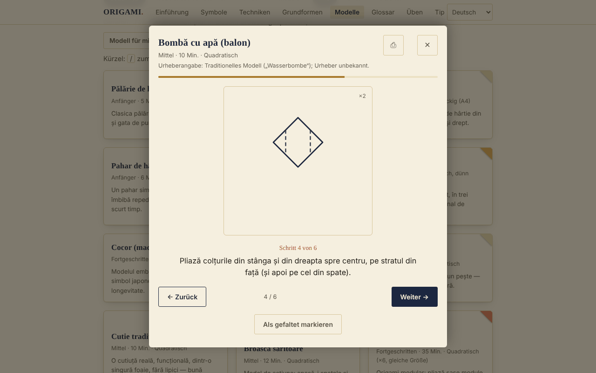

# ORIGAMI — Die Kunst des Papierfaltens

[English](README.md) · [Română](README.ro.md) · [Français](README.fr.md) · [Italiano](README.it.md) · [Español](README.es.md) · [Português](README.pt.md) · **Deutsch** · [Magyar](README.hu.md)

**Version:** 1.2.5 · **Zuletzt aktualisiert:** 2026-10-23

Oberflächensprachen: **Română, English, Français, Italiano, Español, Português (PT), Deutsch, Magyar**

Offline-Origami-Anleitung in einer einzigen HTML-Datei: Faltsymbole, Techniken, Grundformen und 30 Modelle Schritt für Schritt.

**Online:** https://chiuta.github.io/Origami/

## Was es ist

ORIGAMI ist eine interaktive Anleitung auf Rumänisch: eine kurze historische Einführung, die Symbole der Yoshizawa–Randlett-Notation, 5 zusammengesetzte Techniken, 8 Grundformen und ein Katalog von 30 Modellen mit schematischen SVG-Diagrammen und Schritt-für-Schritt-Beschreibungen. Sie öffnet sich aus einer einzigen Datei `index.html`, ohne Server und ohne Konto.

## Funktionen

Im Code und im Browser geprüft (Chromium, Playwright):
- Katalog von 30 Modellen, filterbar nach Stufe (Anfänger / Fortgeschritten / Profi) und Typ (traditionell-volkstümlich / Aktion / modular), mit diakritikfreier Suche (zum Beispiel findet „palarie" „Pălărie").
- Schrittbetrachter (SVG-Diagramm + Text), mit den Schaltflächen Zurück / Weiter, Fortschrittsbalken und Navigation mit den Pfeiltasten links/rechts; Esc schließt ihn.
- Der Dialog hält den Fokus (Tab / Umschalt+Tab), sperrt den Rest der Seite, solange er geöffnet ist, und gibt beim Schließen den Fokus an die Karte des Modells zurück.
- „Als gefaltet markieren" (lokal gespeichert, siehe unten).
- Drucken: Aus dem Betrachter werden alle Schritte des Modells gedruckt, nicht nur der aktuelle.
- Jedes Modell zeigt die Zuschreibung (traditionell / bekannter Urheber / „ungeprüft").
- Fortschritt: Zähler „Gefaltet: N von 30", Filter Alle / Zu tun / Gefaltet, Schaltfläche „Such mir ein Modell aus" (wählt zufällig unter den noch nicht gefalteten im aktuellen Filter), Schaltfläche „Filter zurücksetzen", wenn es keine Ergebnisse gibt.
- Der Betrachter merkt sich bei jedem Modell den zuletzt gesehenen Schritt („Fortgesetzt ab Schritt N"); Pos1 / Ende springen zum ersten / letzten Schritt; die Taste `/` setzt den Fokus auf die Suche.
- „Fortschritt exportieren" / „Fortschritt importieren": Sicherung in der Datei `origami-progres.json` (die gefalteten Modelle und der zuletzt gesehene Schritt); beim Import werden nur gültige ORIGAMI-Dateien akzeptiert, unbekannte Modelle ignoriert und der vorhandene Fortschritt nicht gelöscht.
- Bei Modellen der Stufe „Fortgeschritten" zeigt der Betrachter einen Hinweis: Die Diagramme sind schematisch, der Text des Schritts hat Vorrang, es wird Probepapier und der Vergleich mit einem veröffentlichten Diagramm empfohlen.
- Beachtet `prefers-reduced-motion`; für Mobilgeräte angepasstes Layout (getestet bei 390 px, ohne horizontales Scrollen).

## Neue Funktionen (v1.1.0, 14. Oktober 2026)

### Üben mit verteilter Wiederholung
Neuer Abschnitt „Üben" (Menü → Üben): Karteikarten mit **Vorder-/Rückseite** für die **Faltsymbole, zusammengesetzten Techniken, Grundformen und das Glossar** (Vorderseite = „Faltsymbol: …", „Technik: …", „Grundform: …", „Glossar: …"; Rückseite = die Beschreibung aus der App). Du bewertest dich selbst mit „Nochmal / Schwer / Gut / Leicht" (Tasten 1–4; die Leertaste zeigt die Antwort); der Algorithmus ist **SM-2** (Woźniak, 1990), höchstens 20 neue Karten pro Tag, mit Statistiken (fällig, neu, gereift, Behaltensquote) und Export des Stapels als `.fff.json`. Es nutzt das Modul `srs` des fff-kit; die Karten werden aus den Texten der App erstellt, nicht aus externen Quellen.
- **Speicher:** Der Fortschritt wird in `localStorage` gehalten (Schlüssel `fff.origami.srs.origami` und `fff.origami.srs.__decks`), nur in diesem Browser; er kann unter „Transparenz" → „Löschen" entfernt werden.
- **Grenzen:** Die Karten prüfen *Vokabular und Notation*, nicht das Faltgeschick; die Modelle (die 30) sind keine Karten. Wird die Datei ohne das Kit verwendet (nach `fff-kit/build.mjs remove`), zeigt der Abschnitt eine Meldung, und der Rest der Anleitung funktioniert normal.

### Transparenz und Sicherung (fff-kit)

Ein Klick (oder Enter) auf die angezeigte Version (`v 1.1.0 · 2026-10-14`) öffnet das Fenster „Transparenz": die deklarierten Netzwerk-Hosts (0 externe Anfragen), die lokalen Speicherschlüssel mit Größen, die verwendeten APIs, Größe und SHA-256 der Datei (mit einem Prüfer für eine heruntergeladene Datei) sowie die **Sicherung** der App-Daten in einer `.fff.json`-Datei (optional mit Passwort verschlüsselt, AES-GCM 256 / PBKDF2; das Passwort lässt sich nicht wiederherstellen), Import mit Bestätigung und Löschen der App-Daten. Das Kit (`fff-kit`, Module: core, label, bundle, srs) ist in `index.html` eingefügt, stellt keine Netzwerkanfragen und ändert keine vorhandenen Daten; ohne es funktioniert die App genauso. Die Sicherung umfasst auch den Übungsfortschritt und die vorhandenen Schlüssel `origami-done` / `origami-step`. Die Texte des Kits liegen in 8 Sprachen vor (ro, en, fr, it, es, pt, hu, de); **die Übersetzungen fr/it/es/pt/hu/de sind maschinell und nicht von Muttersprachlern geprüft**. Die Oberfläche der App selbst bleibt auf Rumänisch.

## Bedienungsanleitung

1. Öffne die Seite und wähle einen Abschnitt im oberen Menü (auf dem Handy die Schaltfläche ☰).
2. Lies „Faltsymbole" und „Zusammengesetzte Techniken", bevor du das erste Modell faltest.
3. Scrolle unter „Grundformen" jeden Schrittstreifen horizontal (mit Maus, Finger oder Tastatur, nachdem du ihm den Fokus gegeben hast).
4. Suche unter „Modelle" nach Namen oder filtere nach Stufe und Typ.
5. Drücke auf ein Modell; folge dem Diagramm und dem Text und gehe mit „Weiter →" oder der Pfeiltaste nach rechts durch die Schritte.
6. Drücke am Ende „Als gefaltet markieren"; die Karte erhält das Häkchen „Gefaltet ✓".
7. Für eine Papierkopie drücke ⎙ im Betrachter.

## Datenschutz und Netzwerk

- Lokaler Speicher (ergänzt in v1.1.0): Das Üben mit verteilter Wiederholung hält den Fortschritt in den Schlüsseln `fff.origami.srs.origami` und `fff.origami.srs.__decks`.
- Lokaler Speicher: Verwendet wird `localStorage`, mit den Schlüsseln `origami-done` (die als „gefaltet" markierten Modelle) und `origami-step` (der zuletzt gesehene Schritt je Modell). Blockiert der Browser den Speicher, funktioniert die App ohne ihn.
- Netzwerk: Es gibt keinen externen Aufruf (ich habe im Code kein `fetch`, keine Skripte, Schriften oder Bilder von anderen Hosts gefunden). Die Seite enthält außerdem eine Content-Security-Policy (Skript per Hash, ohne `'unsafe-inline'` für Skripte), die externe Verbindungen und Ressourcen untersagt.
- Browser-Berechtigungen: Sie fordert keine an. Sie enthält keine Telemetrie und kein Konto.

## Grenzen und Hinweise

- Die Anleitungen sind didaktische Rekonstruktionen, und die Diagramme sind schematisch, keine maßstabsgetreuen Zeichnungen. Ich konnte nicht jedes der 30 Modelle physisch auf Papier überprüfen; einige Schritte sind ungefähr (Winkel, Proportionen) und können von den Varianten in Büchern abweichen. Vergleiche bei fortgeschrittenen Modellen mit einem Origami-Buch.
- „Traditionell / volkstümlich" bedeutet ein im Volk verbreitetes Modell. Die Zuschreibung wird im Betrachter angezeigt: Wo der Urheber bekannt ist (zum Beispiel das Sonobe-Modul — Mitsunobu Sonobe; „Toshie's Jewel" — Toshie Takahama), wird er genannt, und wo die Herkunft nicht geprüft wurde, steht das ausdrücklich da.
- Einige Modelle (Fächer, sechszackiger Stern) verwenden Papier, das kein einfaches Quadrat ist; sie folgen nicht der klassischen Regel „ein einziges Quadrat, ohne Schnitte". „Ring aus Geldschein": Übe auf Papier und prüfe die örtlichen Vorschriften, bevor du echtes Geld faltest.
- Die Diagramme verwenden die gepunktete Linie für „Bergfalte"; in Büchern wird üblicherweise die Strich-Punkt-Linie verwendet.
- Das Design folgt `prefers-color-scheme` (automatischer Dunkelmodus).

## Lokale Ausführung / offline

Lade `index.html` herunter und öffne sie im Browser; sie benötigt kein Internet.

## Verlauf / Changelog

### 1.2.4 — 2026-10-22

fff-kit 1.1.4: Touch-Ziele und Mindestschriftgröße.

### 1.2.3 — 2026-10-22
- fff-kit 1.1.2: PBKDF2 mit 600.000 Iterationen, Schutz vor Clickjacking

### 14. Oktober 2026 (v1.1.0)
- Abschnitt „Üben" mit verteilter Wiederholung (fff-kit `srs`); fff-kit (Transparenz + Sicherung). Der Modellkatalog und die Diagramme haben sich nicht geändert.

### 12. Oktober 2026 (v1.0.0)
- 1.2.2 — 2026-10-22: Auf dem Handy springt die Seite beim Öffnen nicht mehr zum Übungsbereich (Fokus und Scrollposition werden wiederhergestellt); Text ≥ 12 px; die Diagramme skalieren bereits (der Schrittstreifen scrollt horizontal).

- 1.0.0 — 2026-10-12: Version und Datum der letzten Aktualisierung werden in der App angezeigt

### 11. Oktober 2026 (dritter Eintrag)
- Export/Import des Fortschritts (JSON), getestet: Export, lokales Löschen, Import, ungültige Datei.
- Hinweis im Betrachter für fortgeschrittene Modelle über den schematischen Charakter der Diagramme.

### 11. Oktober 2026
- Neu: Fortschrittszähler, Statusfilter, „Such mir ein Modell aus", Fortsetzen ab dem letzten Schritt, Pos1/Ende, Kürzel `/`, Zurücksetzen der Filter; CSP mit Hash für das Skript. README: korrigiert, dass es einen Dunkelmodus gibt. Screenshot aktualisiert.
- Barrierefreiheit: Die Kartentitel (Symbole, Techniken, Modelle, Tipps) sind jetzt `h3` unter den `h2`-Abschnitten (axe: 0 Verstöße).
- Kranich: Schritt 6 (Blütenfalte) wurde in zwei Diagramme geteilt (das Anheben mit den Referenzfalten und das Ergebnis „Blüte"), das Modell hat daher jetzt 14 Schritte; Hut: Das Falten der Krempe ist getrennt für Vorder- und Rückseite des Papiers beschrieben (5 Schritte).
- Die Diagramme bleiben schematisch; sehr kurze Modelle (zum Beispiel der Fisch, 4 Schritte) wurden nicht erweitert.

## Lizenz

MIT — siehe Datei LICENSE.

## Autor

Alexio — Alexandru-Ionuț Chiuță, Kontakt: alexio@trom.tf

## Zusammenfassung

ORIGAMI ist eine rumänischsprachige Offline-Origami-Anleitung in einer einzigen Datei: Notationssymbole, 5 zusammengesetzte Techniken, 8 Grundformen und 30 Modelle Schritt für Schritt mit schematischen SVG-Diagrammen. Sie stellt keine Netzwerkanfragen, hat keine Telemetrie und speichert in localStorage nur eine Checkliste der „gefalteten" Modelle. Der Schrittbetrachter ist per Tastatur bedienbar (Fokusfalle, Esc, Pfeiltasten) und druckt alle Schritte eines Modells. Die Anleitungen sind didaktische Rekonstruktionen und nicht alle auf Papier überprüft; die Zuschreibung der Modelle wird in der App angezeigt, mit „ungeprüft", wo die Herkunft nicht bestätigt werden konnte.
