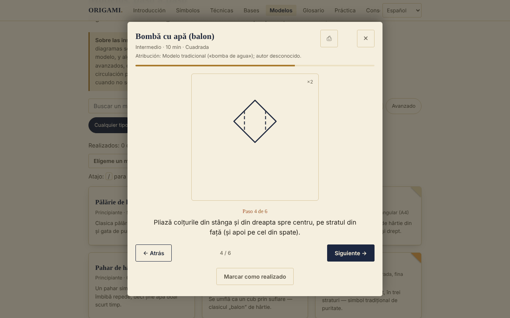

# ORIGAMI — El arte de plegar papel

[English](README.md) · [Română](README.ro.md) · [Français](README.fr.md) · [Italiano](README.it.md) · **Español** · [Português](README.pt.md) · [Deutsch](README.de.md) · [Magyar](README.hu.md)

**Versión:** 1.2.1 · **Última actualización:** 2026-10-19

Idiomas de la interfaz: **Română, English, Français, Italiano, Español, Português (PT), Deutsch, Magyar**

Guía de papiroflexia sin conexión en un único archivo HTML: símbolos de plegado, técnicas, bases fundamentales y 30 modelos paso a paso.

**En línea:** https://chiuta.github.io/Origami/

## Qué es

ORIGAMI es una guía interactiva en rumano: una breve introducción histórica, los símbolos de la notación Yoshizawa–Randlett, 5 técnicas compuestas, 8 bases y un catálogo de 30 modelos con diagramas SVG esquemáticos y descripciones paso a paso. Se abre desde un único archivo `index.html`, sin servidor y sin cuenta.

## Funciones

Verificadas en el código y en el navegador (Chromium, Playwright):
- Catálogo de 30 modelos, filtrable por nivel (principiante / intermedio / avanzado) y tipo (tradicional-popular / acción / modular), con búsqueda sin signos diacríticos (por ejemplo, «palarie» encuentra «Pălărie»).
- Visor paso a paso (diagrama SVG + texto), con botones Atrás / Adelante, barra de progreso y navegación con las flechas izquierda/derecha; Esc lo cierra.
- El cuadro de diálogo retiene el foco (Tab / Mayús+Tab), bloquea el resto de la página mientras está abierto y devuelve el foco a la tarjeta del modelo al cerrarse.
- «Marcar como realizado» (guardado en local, véase más abajo).
- Impresión: desde el visor se imprimen todos los pasos del modelo, no solo el paso actual.
- Cada modelo muestra su atribución (tradicional / autor conocido / «no verificado»).
- Progreso: contador «Realizados: N de 30», filtro Todos / Por hacer / Realizados, botón «Elígeme un modelo» (elige al azar entre los no realizados del filtro actual), botón «Restablecer filtros» cuando no hay resultados.
- El visor recuerda el último paso visto de cada modelo («Retomado desde el paso N»); Inicio / Fin saltan al primer / último paso; la tecla `/` mueve el foco a la búsqueda.
- «Exportar el progreso» / «Importar el progreso»: copia de seguridad en el archivo `origami-progres.json` (los modelos realizados y el último paso visto); al importar solo se aceptan archivos ORIGAMI válidos, se ignoran los modelos desconocidos y no se borra el progreso existente.
- En los modelos de nivel avanzado, el visor muestra una nota: los diagramas son esquemáticos, el texto del paso tiene prioridad, se recomienda papel de prueba y comparar con un diagrama publicado.
- Respeta `prefers-reduced-motion`; diseño adaptado a móviles (probado a 390 px, sin desplazamiento horizontal).

## Novedades (v1.1.0, 14 de octubre de 2026)

### Práctica con repetición espaciada
Nueva sección «Práctica» (menú → Práctica): tarjetas con **anverso/reverso** para los **símbolos de plegado, las técnicas compuestas, las bases y el glosario** (anverso = «Símbolo de plegado: …», «Técnica: …», «Base: …», «Glosario: …»; reverso = la descripción de la aplicación). Te autoevalúas con «De nuevo / Difícil / Bien / Fácil» (teclas 1–4; Espacio muestra la respuesta); el algoritmo es **SM-2** (Woźniak, 1990), con un máximo de 20 tarjetas nuevas al día, con estadísticas (pendientes, nuevas, maduras, retención) y exportación del mazo a `.fff.json`. Usa el módulo `srs` de fff-kit; las tarjetas se crean a partir de los textos de la aplicación, no de fuentes externas.
- **Almacenamiento:** el progreso se guarda en `localStorage` (claves `fff.origami.srs.origami` y `fff.origami.srs.__decks`), solo en este navegador; puede borrarse desde «Transparencia» → «Eliminar».
- **Límites:** las tarjetas ponen a prueba el *vocabulario y la notación*, no la destreza para plegar; los modelos (los 30) no son tarjetas. Si el archivo se usa sin el kit (tras `fff-kit/build.mjs remove`), la sección muestra un mensaje y el resto de la guía funciona con normalidad.

### Transparencia y copia de seguridad (fff-kit)

Un clic (o Intro) en la versión mostrada (`v 1.1.0 · 2026-10-14`) abre la ventana «Transparencia»: los hosts de red declarados (0 solicitudes externas), las claves del almacenamiento local con sus tamaños, las API usadas, el tamaño y el SHA-256 del archivo (con un verificador para un archivo descargado) y la **copia de seguridad** de los datos de la aplicación en un archivo `.fff.json` (opcionalmente cifrado con contraseña, AES-GCM 256 / PBKDF2; la contraseña no se puede recuperar), la importación con confirmación y el borrado de los datos de la aplicación. El kit (`fff-kit`, módulos: core, label, bundle, srs) está incorporado en `index.html`, no realiza solicitudes de red y no modifica los datos existentes; sin él la aplicación funciona igual. La copia de seguridad incluye también el progreso de la práctica y las claves existentes `origami-done` / `origami-step`. Los textos del kit están en 8 idiomas (ro, en, fr, it, es, pt, hu, de); **las traducciones fr/it/es/pt/hu/de son automáticas y no están verificadas por hablantes nativos**. La interfaz de la propia aplicación sigue en rumano.

## Guía de uso

1. Abre la página y elige una sección del menú superior (en el móvil, el botón ☰).
2. Lee «Símbolos del plegado» y «Técnicas compuestas» antes del primer modelo.
3. En «Bases» desplaza horizontalmente cada banda de pasos (con el ratón, el dedo o el teclado, tras darle el foco).
4. En «Modelos» busca por nombre o filtra por nivel y tipo.
5. Pulsa un modelo; sigue el diagrama y el texto y avanza por los pasos con «Adelante →» o con la flecha derecha.
6. Al final pulsa «Marcar como realizado»; la tarjeta recibe la marca «Realizado ✓».
7. Para una copia en papel, pulsa ⎙ en el visor.

## Privacidad y red

- Almacenamiento local (añadido en v1.1.0): la práctica con repetición espaciada guarda su progreso en las claves `fff.origami.srs.origami` y `fff.origami.srs.__decks`.
- Almacenamiento local: se usa `localStorage`, con las claves `origami-done` (los modelos marcados como «realizado») y `origami-step` (el último paso visto por modelo). Si el navegador bloquea el almacenamiento, la aplicación funciona sin él.
- Red: no hay ninguna llamada externa (no encontré en el código `fetch`, scripts, fuentes ni imágenes de otros hosts). La página incluye además una Content-Security-Policy (script por hash, sin `'unsafe-inline'` para scripts) que prohíbe las conexiones y los recursos externos.
- Permisos del navegador: no solicita ninguno. No contiene telemetría ni cuenta.

## Límites y advertencias

- Las instrucciones son reconstrucciones didácticas, y los diagramas son esquemáticos, no dibujos a escala. No pude verificar físicamente en papel cada uno de los 30 modelos; algunos pasos son aproximados (ángulos, proporciones) y pueden diferir de las versiones de los libros. Para los modelos avanzados, compara con un libro de papiroflexia.
- «Tradicional / popular» significa un modelo de circulación popular. La atribución se muestra en el visor: cuando se conoce al autor (por ejemplo, el módulo Sonobe — Mitsunobu Sonobe; «Toshie's Jewel» — Toshie Takahama) se le nombra, y cuando la procedencia no se ha verificado, se dice explícitamente.
- Algunos modelos (abanico, estrella de 6 puntas) usan papel que no es un cuadrado simple; no cumplen la regla clásica «un solo cuadrado, sin cortes». «Anillo de billete»: practica con papel y comprueba la legislación local antes de plegar dinero real.
- Los diagramas usan la línea de puntos para la «montaña»; en los libros se suele usar la línea de punto y raya.
- El tema sigue `prefers-color-scheme` (modo oscuro automático).

## Ejecución local / sin conexión

Descarga `index.html` y ábrelo en un navegador; no requiere internet.

## Historial / Changelog

### 14 de octubre de 2026 (v1.1.0)
- Sección «Práctica» con repetición espaciada (fff-kit `srs`); fff-kit (Transparencia + copia de seguridad). El catálogo de modelos y los diagramas no han cambiado.

### 12 de octubre de 2026 (v1.0.0)
- 1.2.2 — 2026-10-22: En móvil la página ya no salta al panel de práctica al abrir (se restauran el foco y la posición de desplazamiento); texto ≥ 12 px; los diagramas ya se escalan (la tira de pasos se desplaza en horizontal).

- 1.0.0 — 2026-10-12: la versión y la fecha de la última actualización se muestran en la aplicación

### 11 de octubre de 2026 (tercera entrada)
- Exportación/importación del progreso (JSON), probada: exportación, borrado local, importación, archivo no válido.
- Nota en el visor para los modelos avanzados, sobre el carácter esquemático de los diagramas.

### 11 de octubre de 2026
- Novedad: contador de progreso, filtro de estado, «Elígeme un modelo», reanudación desde el último paso, Inicio/Fin, atajo `/`, restablecimiento de filtros; CSP con hash para el script. README: corregido que existe modo oscuro. Captura de pantalla actualizada.
- Accesibilidad: los títulos de las tarjetas (símbolos, técnicas, modelos, consejos) son ahora `h3` bajo las secciones `h2` (axe: 0 infracciones).
- Grulla: el paso 6 (pliegue de pétalo) se dividió en dos diagramas (la elevación con los pliegues de referencia y el resultado «pétalo»), por lo que el modelo tiene ahora 14 pasos; Sombrero: el plegado del ala se detalla por separado en el anverso y el reverso del papel (5 pasos).
- Los diagramas siguen siendo esquemáticos; los modelos muy cortos (por ejemplo, el Pez, 4 pasos) no se ampliaron.

## Licencia

MIT — véase el archivo LICENSE.

## Autor

Alexio — Alexandru-Ionuț Chiuță, contacto: alexio@trom.tf

## Resumen

ORIGAMI es una guía de papiroflexia sin conexión, de un solo archivo y en rumano: símbolos de notación, 5 técnicas compuestas, 8 bases y 30 modelos paso a paso con diagramas SVG esquemáticos. No realiza solicitudes de red, no tiene telemetría y solo guarda en localStorage una lista de control de los modelos «realizados». El visor de pasos es accesible con teclado (trampa de foco, Esc, flechas) e imprime todos los pasos de un modelo. Las instrucciones son reconstrucciones didácticas y no todas se han verificado en papel; la atribución de los modelos se muestra en la aplicación, con «no verificado» cuando no se pudo confirmar la procedencia.
