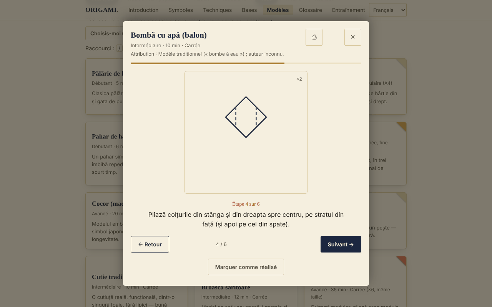

# ORIGAMI — L'art du pliage du papier

[English](README.md) · [Română](README.ro.md) · **Français** · [Italiano](README.it.md) · [Español](README.es.md) · [Português](README.pt.md) · [Deutsch](README.de.md) · [Magyar](README.hu.md)

**Version :** 1.2.3 · **Dernière mise à jour :** 2026-10-22

Langues de l'interface : **Română, English, Français, Italiano, Español, Português (PT), Deutsch, Magyar**

Guide d'origami hors ligne dans un seul fichier HTML : symboles de pliage, techniques, bases fondamentales et 30 modèles pas à pas.

**En ligne :** https://chiuta.github.io/Origami/

## De quoi s'agit-il

ORIGAMI est un guide interactif en roumain : une brève introduction historique, les symboles de la notation Yoshizawa–Randlett, 5 techniques composées, 8 bases et un catalogue de 30 modèles avec des diagrammes SVG schématiques et des descriptions pas à pas. Il s'ouvre à partir d'un seul fichier `index.html`, sans serveur et sans compte.

## Fonctionnalités

Vérifiées dans le code et dans le navigateur (Chromium, Playwright) :
- Catalogue de 30 modèles, filtrable par niveau (débutant / intermédiaire / avancé) et par type (traditionnel-populaire / action / modulaire), avec recherche sans diacritiques (par exemple « palarie » trouve « Pălărie »).
- Visionneuse pas à pas (diagramme SVG + texte), avec boutons Précédent / Suivant, barre de progression et navigation par les flèches gauche/droite ; Échap la ferme.
- La boîte de dialogue retient le focus (Tab / Maj+Tab), bloque le reste de la page tant qu'elle est ouverte et rend le focus à la carte du modèle à la fermeture.
- « Marquer comme réalisé » (enregistré localement, voir plus bas).
- Impression : depuis la visionneuse, toutes les étapes du modèle sont imprimées, pas seulement l'étape en cours.
- Chaque modèle indique son attribution (traditionnel / auteur connu / « non vérifié »).
- Progression : compteur « Réalisés : N sur 30 », filtre Tous / À faire / Réalisés, bouton « Choisis-moi un modèle » (choisit au hasard parmi les modèles non réalisés du filtre courant), bouton « Réinitialiser les filtres » lorsqu'il n'y a aucun résultat.
- La visionneuse se souvient de la dernière étape vue pour chaque modèle (« Reprise à l'étape N ») ; Début / Fin sautent à la première / dernière étape ; la touche `/` place le focus sur la recherche.
- « Exporter la progression » / « Importer la progression » : sauvegarde dans le fichier `origami-progres.json` (les modèles réalisés et la dernière étape vue) ; à l'import, seuls les fichiers ORIGAMI valides sont acceptés, les modèles inconnus sont ignorés et la progression existante n'est pas effacée.
- Pour les modèles de niveau avancé, la visionneuse affiche une note : les diagrammes sont schématiques, le texte de l'étape prime, il est recommandé d'utiliser du papier d'essai et de comparer avec un diagramme publié.
- Respecte `prefers-reduced-motion` ; mise en page adaptée aux mobiles (testée à 390 px, sans défilement horizontal).

## Nouveautés (v1.1.0, 14 octobre 2026)

### Entraînement par répétition espacée
Nouvelle section « Entraînement » (menu → Entraînement) : cartes **recto/verso** pour les **symboles de pliage, les techniques composées, les bases et le glossaire** (recto = « Symbole de pliage : … », « Technique : … », « Base : … », « Glossaire : … » ; verso = la description de l'application). Vous vous auto-évaluez avec « À revoir / Difficile / Bien / Facile » (touches 1–4 ; Espace montre la réponse) ; l'algorithme est **SM-2** (Woźniak, 1990), avec au maximum 20 nouvelles cartes par jour, des statistiques (à réviser, nouvelles, mûres, rétention) et l'export du paquet en `.fff.json`. Il utilise le module `srs` de fff-kit ; les cartes sont créées à partir des textes de l'application, non de sources externes.
- **Stockage :** la progression est conservée dans `localStorage` (clés `fff.origami.srs.origami` et `fff.origami.srs.__decks`), uniquement dans ce navigateur ; elle peut être effacée depuis « Transparence » → « Supprimer ».
- **Limites :** les cartes testent le *vocabulaire et la notation*, pas l'habileté au pliage ; les modèles (les 30) ne sont pas des cartes. Si le fichier est utilisé sans le kit (après `fff-kit/build.mjs remove`), la section affiche un message et le reste du guide fonctionne normalement.

### Transparence et sauvegarde (fff-kit)

Un clic (ou Entrée) sur la version affichée (`v 1.1.0 · 2026-10-14`) ouvre la fenêtre « Transparence » : les hôtes réseau déclarés (0 requête externe), les clés de stockage local avec leurs tailles, les API utilisées, la taille et le SHA-256 du fichier (avec un vérificateur pour un fichier téléchargé) et la **sauvegarde** des données de l'application dans un fichier `.fff.json` (éventuellement chiffré par mot de passe, AES-GCM 256 / PBKDF2 ; le mot de passe ne peut pas être récupéré), l'import avec confirmation et la suppression des données de l'application. Le kit (`fff-kit`, modules : core, label, bundle, srs) est intégré dans `index.html`, n'effectue aucune requête réseau et ne modifie pas les données existantes ; sans lui, l'application fonctionne de la même façon. La sauvegarde inclut aussi la progression de l'entraînement et les clés existantes `origami-done` / `origami-step`. Les textes du kit sont en 8 langues (ro, en, fr, it, es, pt, hu, de) ; **les traductions fr/it/es/pt/hu/de sont automatiques et non vérifiées par des locuteurs natifs**. L'interface de l'application elle-même reste en roumain.

## Mode d'emploi

1. Ouvrez la page et choisissez une section dans le menu du haut (sur mobile, le bouton ☰).
2. Lisez « Symboles du pliage » et « Techniques composées » avant le premier modèle.
3. Dans « Bases », faites défiler horizontalement chaque bande d'étapes (à la souris, au doigt ou au clavier, après lui avoir donné le focus).
4. Dans « Modèles », cherchez par nom ou filtrez par niveau et par type.
5. Appuyez sur un modèle ; suivez le diagramme et le texte et passez d'une étape à l'autre avec « Suivant → » ou avec la flèche droite.
6. À la fin, appuyez sur « Marquer comme réalisé » ; la carte reçoit la coche « Réalisé ✓ ».
7. Pour une copie papier, appuyez sur ⎙ dans la visionneuse.

## Confidentialité et réseau

- Stockage local (ajout v1.1.0) : l'entraînement par répétition espacée conserve sa progression dans les clés `fff.origami.srs.origami` et `fff.origami.srs.__decks`.
- Stockage local : `localStorage` est utilisé, avec les clés `origami-done` (les modèles marqués « réalisé ») et `origami-step` (la dernière étape vue par modèle). Si le navigateur bloque le stockage, l'application fonctionne sans lui.
- Réseau : il n'y a aucun appel externe (je n'ai trouvé dans le code aucun `fetch`, script, police ou image provenant d'autres hôtes). La page inclut aussi une politique Content-Security-Policy (script par empreinte, sans `'unsafe-inline'` pour les scripts) qui interdit les connexions et les ressources externes.
- Autorisations du navigateur : aucune n'est demandée. Elle ne contient ni télémétrie ni compte.

## Limites et avertissements

- Les instructions sont des reconstitutions didactiques, et les diagrammes sont schématiques, non des dessins à l'échelle. Je n'ai pas pu vérifier physiquement, sur papier, chacun des 30 modèles ; certaines étapes sont approximatives (angles, proportions) et peuvent différer des versions des livres. Pour les modèles avancés, comparez avec un livre d'origami.
- « Traditionnel / populaire » désigne un modèle de circulation populaire. L'attribution est affichée dans la visionneuse : lorsque l'auteur est connu (par exemple le module Sonobe — Mitsunobu Sonobe ; « Toshie's Jewel » — Toshie Takahama), il est nommé, et lorsque la provenance n'a pas été vérifiée, c'est écrit explicitement.
- Certains modèles (éventail, étoile à 6 branches) utilisent un papier qui n'est pas un simple carré ; ils ne respectent pas la règle classique « un seul carré, sans découpe ». « Anneau en billet » : exercez-vous sur du papier et vérifiez la législation locale avant de plier de la vraie monnaie.
- Les diagrammes utilisent la ligne pointillée pour la « montagne » ; dans les livres, on utilise généralement la ligne point–trait.
- Le thème suit `prefers-color-scheme` (mode sombre automatique).

## Exécution en local / hors ligne

Téléchargez `index.html` et ouvrez-le dans un navigateur ; il ne nécessite pas internet.

## Historique / Changelog

### 1.2.3 — 2026-10-22
- fff-kit 1.1.2 : PBKDF2 à 600 000 itérations, protection anti-clickjacking

### 14 octobre 2026 (v1.1.0)
- Section « Entraînement » avec répétition espacée (fff-kit `srs`) ; fff-kit (Transparence + sauvegarde). Le catalogue de modèles et les diagrammes n'ont pas changé.

### 12 octobre 2026 (v1.0.0)
- 1.2.2 — 2026-10-22 : Sur mobile, la page ne saute plus au panneau d'exercice à l'ouverture (focus et position de défilement restaurés) ; texte ≥ 12 px ; les diagrammes s'adaptent déjà (la bande d'étapes défile horizontalement).

- 1.0.0 — 2026-10-12 : la version et la date de la dernière mise à jour sont affichées dans l'application

### 11 octobre 2026 (troisième entrée)
- Export/import de la progression (JSON), testé : export, suppression locale, import, fichier invalide.
- Note dans la visionneuse pour les modèles avancés, sur le caractère schématique des diagrammes.

### 11 octobre 2026
- Nouveau : compteur de progression, filtre d'état, « Choisis-moi un modèle », reprise à la dernière étape, Début/Fin, raccourci `/`, réinitialisation des filtres ; CSP avec empreinte pour le script. README : correction, le mode sombre existe bel et bien. Capture d'écran mise à jour.
- Accessibilité : les titres des cartes (symboles, techniques, modèles, conseils) sont désormais des `h3` sous les sections `h2` (axe : 0 violation).
- Grue : l'étape 6 (pliage en pétale) a été scindée en deux diagrammes (le soulèvement avec les plis de référence et le résultat « pétale »), le modèle compte donc désormais 14 étapes ; Chapeau : le pliage du bord est détaillé séparément sur le recto et le verso du papier (5 étapes).
- Les diagrammes restent schématiques ; les modèles très courts (par exemple le Poisson, 4 étapes) n'ont pas été étoffés.

## Licence

MIT — voir le fichier LICENSE.

## Auteur

Alexio — Alexandru-Ionuț Chiuță, contact : alexio@trom.tf

## Résumé

ORIGAMI est un guide d'origami hors ligne, en un seul fichier et en langue roumaine : symboles de notation, 5 techniques composées, 8 bases et 30 modèles pas à pas avec des diagrammes SVG schématiques. Il n'effectue aucune requête réseau, n'a pas de télémétrie et ne stocke dans localStorage qu'une liste de contrôle des modèles « réalisés ». La visionneuse d'étapes est accessible au clavier (piégeage du focus, Échap, flèches) et imprime toutes les étapes d'un modèle. Les instructions sont des reconstitutions didactiques et n'ont pas toutes été vérifiées sur papier ; l'attribution des modèles est affichée dans l'application, avec « non vérifié » lorsque la provenance n'a pu être confirmée.
