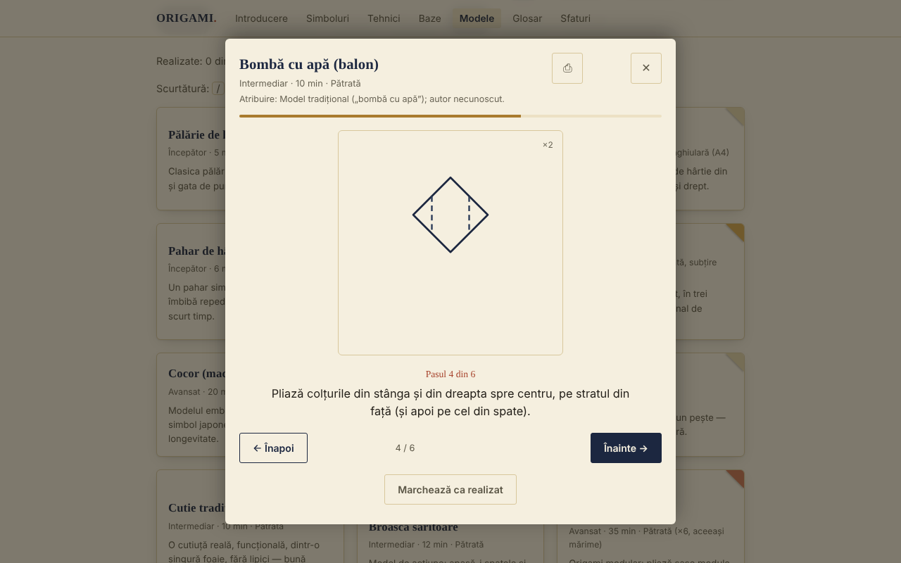

# ORIGAMI — A papírhajtogatás művészete

[English](README.md) · [Română](README.ro.md) · [Français](README.fr.md) · [Italiano](README.it.md) · [Español](README.es.md) · [Português](README.pt.md) · [Deutsch](README.de.md) · **Magyar**

**Verzió:** 1.1.0 · **Utolsó frissítés:** 2026-10-14

Offline origami-útmutató egyetlen HTML-fájlban: hajtogatási jelek, technikák, alapformák és 30 lépésről lépésre bemutatott modell.

**Élő változat:** https://chiuta.github.io/Origami/

## Mi ez

Az ORIGAMI egy interaktív útmutató román nyelven: rövid történeti bevezető, a Yoshizawa–Randlett-jelölés szimbólumai, 5 összetett technika, 8 alapforma és 30 modell katalógusa vázlatos SVG-diagramokkal és lépésenkénti leírásokkal. Egyetlen `index.html` fájlból nyílik meg, szerver és fiók nélkül.

## Funkciók

Kódban és böngészőben ellenőrizve (Chromium, Playwright):
- 30 modell katalógusa, szűrhető szint (kezdő / haladó / profi) és típus (hagyományos-népi / mozgó / moduláris) szerint, ékezetek nélküli kereséssel (például a „palarie” megtalálja a „Pălărie” szót).
- Lépésenkénti megjelenítő (SVG-diagram + szöveg), Vissza / Tovább gombokkal, folyamatjelzővel és a bal/jobb nyilakkal történő navigációval; az Esc bezárja.
- A párbeszédablak megtartja a fókuszt (Tab / Shift+Tab), nyitott állapotában blokkolja az oldal többi részét, bezáráskor pedig visszaadja a fókuszt a modell kártyájának.
- „Megjelölés elkészültként” (helyben mentve, lásd lent).
- Nyomtatás: a megjelenítőből a modell összes lépése kinyomtatódik, nem csak az aktuális.
- Minden modell mutatja a származását (hagyományos / ismert szerző / „ellenőrizetlen”).
- Haladás: „Elkészült: N a 30-ból” számláló, Mind / Teendő / Elkészült szűrő, „Válassz nekem egy modellt” gomb (véletlenszerűen választ az aktuális szűrőben még el nem készültek közül), „Szűrők visszaállítása” gomb, ha nincs találat.
- A megjelenítő modellenként megjegyzi az utoljára látott lépést („Folytatva az N. lépéstől”); a Home / End az első / utolsó lépésre ugrik; a `/` billentyű a keresőre teszi a fókuszt.
- „Haladás exportálása” / „Haladás importálása”: biztonsági mentés az `origami-progres.json` fájlba (az elkészült modellek és az utoljára látott lépés); importáláskor csak érvényes ORIGAMI-fájlokat fogad el, az ismeretlen modelleket figyelmen kívül hagyja, a meglévő haladást pedig nem törli.
- A haladó szintű modelleknél a megjelenítő megjegyzést mutat: a diagramok vázlatosak, a lépés szövege az elsődleges, ajánlott a próbapapír és a közzétett diagrammal való összevetés.
- Tiszteletben tartja a `prefers-reduced-motion` beállítást; mobilbarát elrendezés (390 px-en tesztelve, vízszintes görgetés nélkül).

## Újdonságok (v1.1.0, 2026. október 14.)

### Gyakorlás elosztott ismétléssel
Új „Gyakorlás” szakasz (menü → Gyakorlás): **előlap/hátlap** kártyák a **hajtogatási jelekhez, az összetett technikákhoz, az alapformákhoz és a szójegyzékhez** (előlap = „Hajtogatási jel: …”, „Technika: …”, „Alapforma: …”, „Szójegyzék: …”; hátlap = az alkalmazásban szereplő leírás). Az „Újra / Nehéz / Jó / Könnyű” gombokkal értékeled magad (1–4 billentyűk; a Szóköz megmutatja a választ); az algoritmus az **SM-2** (Woźniak, 1990), naponta legfeljebb 20 új kártyával, statisztikákkal (esedékes, új, érett, megőrzés) és a pakli `.fff.json` fájlba exportálásával. Az fff-kit `srs` modulját használja; a kártyák az alkalmazás szövegeiből készülnek, nem külső forrásokból.
- **Tárolás:** a haladás a `localStorage`-ban marad (`fff.origami.srs.origami` és `fff.origami.srs.__decks` kulcsok), csak ebben a böngészőben; az „Átláthatóság” → „Törlés” menüpontból törölhető.
- **Korlátok:** a kártyák a *szókincset és a jelölést* vizsgálják, nem a hajtogatási készséget; a modellek (a 30) nem kártyák. Ha a fájlt a kit nélkül használják (a `fff-kit/build.mjs remove` után), a szakasz üzenetet jelenít meg, az útmutató többi része pedig normálisan működik.

### Átláthatóság és biztonsági mentés (fff-kit)

A megjelenített verzióra (`v 1.1.0 · 2026-10-14`) kattintva (vagy Entert nyomva) megnyílik az „Átláthatóság” ablak: a deklarált hálózati hostok (0 külső kérés), a helyi tárolás kulcsai méretekkel, a használt API-k, a fájl mérete és SHA-256 értéke (letöltött fájl ellenőrzőjével), valamint az alkalmazásadatok **biztonsági mentése** `.fff.json` fájlba (opcionálisan jelszóval titkosítva, AES-GCM 256 / PBKDF2; a jelszó nem állítható vissza), importálás megerősítéssel és az alkalmazásadatok törlése. A kit (`fff-kit`, modulok: core, label, bundle, srs) be van illesztve az `index.html` fájlba, nem küld hálózati kéréseket, és nem módosítja a meglévő adatokat; nélküle az alkalmazás ugyanígy működik. A biztonsági mentés a gyakorlási haladást és a meglévő `origami-done` / `origami-step` kulcsokat is tartalmazza. A kit szövegei 8 nyelven vannak (ro, en, fr, it, es, pt, hu, de); **az fr/it/es/pt/hu/de fordítások automatikusak, és anyanyelvi beszélők nem ellenőrizték őket**. Maga az alkalmazás felülete román marad.

## Használati útmutató

1. Nyisd meg az oldalt, és válassz szakaszt a felső menüből (mobilon a ☰ gomb).
2. Az első modell előtt olvasd el a „Hajtogatás jelei” és az „Összetett technikák” szakaszt.
3. Az „Alapformák” alatt görgesd vízszintesen az egyes lépéssávokat (egérrel, ujjal vagy billentyűzettel, miután fókuszt adtál nekik).
4. A „Modellek” alatt keress név szerint, vagy szűrj szint és típus szerint.
5. Nyomj egy modellre; kövesd a diagramot és a szöveget, és lépkedj a lépéseken a „Tovább →” gombbal vagy a jobbra nyíllal.
6. A végén nyomd meg az „Megjelölés elkészültként” gombot; a kártya megkapja az „Elkészült ✓” pipát.
7. Papírmásolathoz nyomd meg a ⎙ gombot a megjelenítőben.

## Adatvédelem és hálózat

- Helyi tárolás (a v1.1.0-ban hozzáadva): az elosztott ismétléssel történő gyakorlás a haladását a `fff.origami.srs.origami` és `fff.origami.srs.__decks` kulcsokban őrzi.
- Helyi tárolás: `localStorage`-ot használ, az `origami-done` (az „elkészült”-nek jelölt modellek) és az `origami-step` (modellenként az utoljára látott lépés) kulcsokkal. Ha a böngésző blokkolja a tárolást, az alkalmazás nélküle is működik.
- Hálózat: nincs külső hívás (a kódban nem találtam `fetch`-et, más hostokról származó szkripteket, betűtípusokat vagy képeket). Az oldal tartalmaz Content-Security-Policy-t is (szkript hash alapján, a szkriptekhez `'unsafe-inline'` nélkül), amely tiltja a külső kapcsolatokat és erőforrásokat.
- Böngészőengedélyek: egyet sem kér. Nem tartalmaz telemetriát vagy fiókot.

## Korlátok és figyelmeztetések

- Az utasítások didaktikus rekonstrukciók, a diagramok pedig vázlatosak, nem méretarányos rajzok. Nem tudtam fizikailag, papíron ellenőrizni mind a 30 modellt; néhány lépés megközelítő (szögek, arányok), és eltérhet a könyvekben szereplő változatoktól. A haladó modelleknél vesd össze egy origamikönyvvel.
- A „hagyományos / népi” népi forgalomban lévő modellt jelent. A származás a megjelenítőben látható: ahol a szerző ismert (például a Sonobe-modul — Mitsunobu Sonobe; „Toshie's Jewel” — Toshie Takahama), ott megnevezi, ahol pedig a származást nem ellenőrizték, ott ezt kifejezetten kiírja.
- Néhány modell (legyező, hatágú csillag) nem egyszerű négyzet alakú papírt használ; nem felelnek meg a klasszikus „egyetlen négyzet, vágás nélkül” szabálynak. „Bankjegygyűrű”: gyakorolj papíron, és ellenőrizd a helyi jogszabályokat, mielőtt valódi pénzt hajtogatsz.
- A diagramok a „hegy” jelölésére a pontozott vonalat használják; a könyvekben általában a pont–szaggatott vonalat.
- A téma követi a `prefers-color-scheme` beállítást (automatikus sötét mód).

## Futtatás helyben / offline

Töltsd le az `index.html` fájlt, és nyisd meg böngészőben; nem igényel internetet.

## Előzmények / Changelog

### 2026. október 14. (v1.1.0)
- „Gyakorlás” szakasz elosztott ismétléssel (fff-kit `srs`); fff-kit (Átláthatóság + biztonsági mentés). A modellkatalógus és a diagramok nem változtak.

### 2026. október 12. (v1.0.0)
- 1.0.0 — 2026-10-12: a verzió és az utolsó frissítés dátuma megjelenik az alkalmazásban

### 2026. október 11. (harmadik bejegyzés)
- A haladás exportálása/importálása (JSON), tesztelve: exportálás, helyi törlés, importálás, érvénytelen fájl.
- Megjegyzés a megjelenítőben a haladó modellekhez, a diagramok vázlatos jellegéről.

### 2026. október 11.
- Új: haladásszámláló, állapotszűrő, „Válassz nekem egy modellt”, folytatás az utolsó lépéstől, Home/End, `/` billentyűparancs, a szűrők visszaállítása; CSP hash-sel a szkripthez. README: javítva, hogy létezik sötét mód. A képernyőkép frissítve.
- Hozzáférhetőség: a kártyák címei (jelek, technikák, modellek, tippek) mostantól `h3` elemek a `h2` szakaszok alatt (axe: 0 szabálysértés).
- Daru: a 6. lépést (szirom-hajtás) két diagramra bontottuk (az emelés a viszonyítási hajtásokkal és a „szirom” eredmény), így a modell mostantól 14 lépésből áll; Kalap: a karimahajtás külön van részletezve a papír előlapján és hátlapján (5 lépés).
- A diagramok továbbra is vázlatosak; a nagyon rövid modelleket (például a Halat, 4 lépés) nem bővítettük.

## Licenc

MIT — lásd a LICENSE fájlt.

## Szerző

Alexio — Alexandru-Ionuț Chiuță, elérhetőség: alexio@trom.tf

## Összefoglaló

Az ORIGAMI egyfájlos, offline, román nyelvű origami-útmutató: jelölési szimbólumok, 5 összetett technika, 8 alapforma és 30 lépésről lépésre bemutatott modell vázlatos SVG-diagramokkal. Nem küld hálózati kéréseket, nincs benne telemetria, és a localStorage-ban csak az „elkészült” modellek ellenőrzőlistáját tárolja. A lépésmegjelenítő billentyűzettel is használható (fókuszcsapda, Esc, nyilak), és kinyomtatja egy modell összes lépését. Az utasítások didaktikus rekonstrukciók, és nem mindegyiket ellenőrizték papíron; a modellek származása az alkalmazásban látható, „ellenőrizetlen” jelöléssel ott, ahol a származást nem lehetett megerősíteni.
