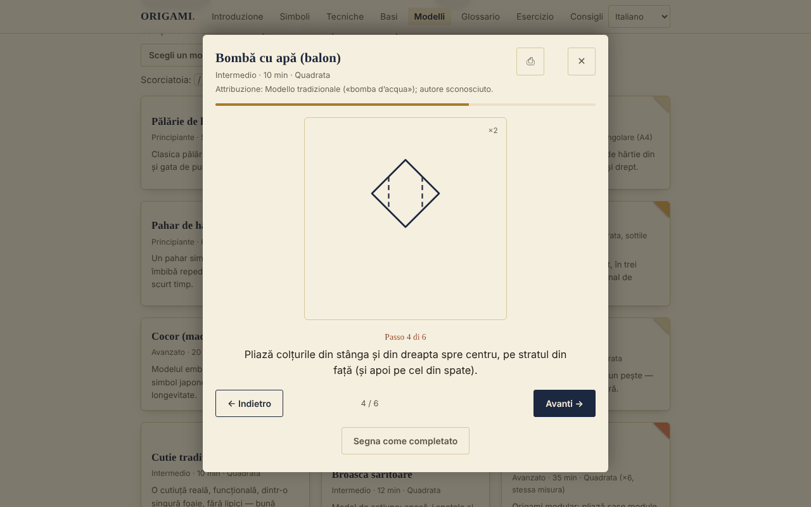

# ORIGAMI — L'arte di piegare la carta

[English](README.md) · [Română](README.ro.md) · [Français](README.fr.md) · **Italiano** · [Español](README.es.md) · [Português](README.pt.md) · [Deutsch](README.de.md) · [Magyar](README.hu.md)

**Versione:** 1.2.5 · **Ultimo aggiornamento:** 2026-10-23

Lingue dell'interfaccia: **Română, English, Français, Italiano, Español, Português (PT), Deutsch, Magyar**

Guida all'origami offline in un unico file HTML: simboli di piegatura, tecniche, basi fondamentali e 30 modelli passo per passo.

**Online:** https://chiuta.github.io/Origami/

## Che cos'è

ORIGAMI è una guida interattiva in lingua rumena: una breve introduzione storica, i simboli della notazione Yoshizawa–Randlett, 5 tecniche composte, 8 basi e un catalogo di 30 modelli con diagrammi SVG schematici e descrizioni passo per passo. Si apre da un unico file `index.html`, senza server e senza account.

## Funzioni

Verificate nel codice e nel browser (Chromium, Playwright):
- Catalogo di 30 modelli, filtrabile per livello (principiante / intermedio / avanzato) e tipo (tradizionale-popolare / azione / modulare), con ricerca senza segni diacritici (ad esempio «palarie» trova «Pălărie»).
- Visualizzatore passo per passo (diagramma SVG + testo), con pulsanti Indietro / Avanti, barra di avanzamento e navigazione con le frecce sinistra/destra; Esc lo chiude.
- La finestra di dialogo trattiene il focus (Tab / Maiusc+Tab), blocca il resto della pagina finché è aperta e restituisce il focus alla scheda del modello alla chiusura.
- «Segna come realizzato» (salvato in locale, vedi sotto).
- Stampa: dal visualizzatore si stampano tutti i passaggi del modello, non solo quello corrente.
- Ogni modello mostra l'attribuzione (tradizionale / autore noto / «non verificato»).
- Avanzamento: contatore «Realizzati: N su 30», filtro Tutti / Da fare / Realizzati, pulsante «Scegli un modello per me» (sceglie a caso tra quelli non ancora realizzati nel filtro corrente), pulsante «Reimposta i filtri» quando non ci sono risultati.
- Il visualizzatore ricorda l'ultimo passaggio visto per ogni modello («Ripreso dal passaggio N»); Home / Fine saltano al primo / ultimo passaggio; il tasto `/` sposta il focus sulla ricerca.
- «Esporta l'avanzamento» / «Importa l'avanzamento»: copia di sicurezza nel file `origami-progres.json` (i modelli realizzati e l'ultimo passaggio visto); all'importazione si accettano solo file ORIGAMI validi, i modelli sconosciuti vengono ignorati e l'avanzamento esistente non viene cancellato.
- Per i modelli di livello avanzato, il visualizzatore mostra una nota: i diagrammi sono schematici, il testo del passaggio ha la precedenza, si consiglia carta di prova e il confronto con un diagramma pubblicato.
- Rispetta `prefers-reduced-motion`; layout adattato ai dispositivi mobili (testato a 390 px, senza scorrimento orizzontale).

## Novità (v1.1.0, 14 ottobre 2026)

### Esercizio con ripetizione dilazionata
Nuova sezione «Esercizio» (menu → Esercizio): schede **fronte/retro** per i **simboli di piegatura, le tecniche composte, le basi e il glossario** (fronte = «Simbolo di piegatura: …», «Tecnica: …», «Base: …», «Glossario: …»; retro = la descrizione presente nell'app). Ti autovaluti con «Di nuovo / Difficile / Bene / Facile» (tasti 1–4; Spazio mostra la risposta); l'algoritmo è **SM-2** (Woźniak, 1990), massimo 20 schede nuove al giorno, con statistiche (in scadenza, nuove, mature, ritenzione) ed esportazione del mazzo in `.fff.json`. Usa il modulo `srs` di fff-kit; le schede sono create dai testi dell'app, non da fonti esterne.
- **Archiviazione:** l'avanzamento è conservato in `localStorage` (chiavi `fff.origami.srs.origami` e `fff.origami.srs.__decks`), solo in questo browser; può essere cancellato da «Trasparenza» → «Elimina».
- **Limiti:** le schede verificano il *vocabolario e la notazione*, non l'abilità nel piegare; i modelli (i 30) non sono schede. Se il file viene usato senza il kit (dopo `fff-kit/build.mjs remove`), la sezione mostra un messaggio e il resto della guida funziona normalmente.

### Trasparenza e copia di sicurezza (fff-kit)

Un clic (o Invio) sulla versione mostrata (`v 1.1.0 · 2026-10-14`) apre la finestra «Trasparenza»: gli host di rete dichiarati (0 richieste esterne), le chiavi di archiviazione locale con le dimensioni, le API usate, la dimensione e lo SHA-256 del file (con un verificatore per un file scaricato) e la **copia di sicurezza** dei dati dell'app in un file `.fff.json` (facoltativamente cifrato con password, AES-GCM 256 / PBKDF2; la password non è recuperabile), l'importazione con conferma e la cancellazione dei dati dell'app. Il kit (`fff-kit`, moduli: core, label, bundle, srs) è incorporato in `index.html`, non effettua richieste di rete e non modifica i dati esistenti; senza di esso l'app funziona allo stesso modo. La copia di sicurezza include anche l'avanzamento dell'esercizio e le chiavi esistenti `origami-done` / `origami-step`. I testi del kit sono in 8 lingue (ro, en, fr, it, es, pt, hu, de); **le traduzioni fr/it/es/pt/hu/de sono automatiche e non verificate da madrelingua**. L'interfaccia dell'app stessa rimane in rumeno.

## Guida all'uso

1. Apri la pagina e scegli una sezione dal menu in alto (su mobile, il pulsante ☰).
2. Leggi «Simboli della piegatura» e «Tecniche composte» prima del primo modello.
3. In «Basi» scorri orizzontalmente ogni striscia di passaggi (con il mouse, il dito o la tastiera, dopo avergli dato il focus).
4. In «Modelli» cerca per nome o filtra per livello e tipo.
5. Premi un modello; segui il diagramma e il testo e passa da un passaggio all'altro con «Avanti →» o con la freccia destra.
6. Alla fine premi «Segna come realizzato»; la scheda riceve il segno «Realizzato ✓».
7. Per una copia su carta, premi ⎙ nel visualizzatore.

## Privacy e rete

- Archiviazione locale (aggiunta v1.1.0): l'esercizio con ripetizione dilazionata conserva l'avanzamento nelle chiavi `fff.origami.srs.origami` e `fff.origami.srs.__decks`.
- Archiviazione locale: si usa `localStorage`, con le chiavi `origami-done` (i modelli segnati come «realizzato») e `origami-step` (l'ultimo passaggio visto per modello). Se il browser blocca l'archiviazione, l'app funziona senza di essa.
- Rete: non esiste alcuna chiamata esterna (nel codice non ho trovato `fetch`, script, font o immagini provenienti da altri host). La pagina include anche una Content-Security-Policy (script tramite hash, senza `'unsafe-inline'` per gli script) che vieta connessioni e risorse esterne.
- Permessi del browser: non ne richiede alcuno. Non contiene telemetria né account.

## Limiti e avvertenze

- Le istruzioni sono ricostruzioni didattiche, e i diagrammi sono schematici, non disegni in scala. Non ho potuto verificare fisicamente su carta ciascuno dei 30 modelli; alcuni passaggi sono approssimativi (angoli, proporzioni) e possono differire dalle versioni dei libri. Per i modelli avanzati confrontati con un libro di origami.
- «Tradizionale / popolare» significa un modello di circolazione popolare. L'attribuzione è mostrata nel visualizzatore: dove l'autore è noto (ad esempio il modulo Sonobe — Mitsunobu Sonobe; «Toshie's Jewel» — Toshie Takahama) viene nominato, e dove la provenienza non è stata verificata, lo dice esplicitamente.
- Alcuni modelli (ventaglio, stella a 6 punte) usano carta che non è un semplice quadrato; non rispettano la regola classica «un solo quadrato, senza tagli». «Anello da banconota»: esercitati su carta e verifica la legislazione locale prima di piegare denaro vero.
- I diagrammi usano la linea tratteggiata per la «montagna»; nei libri si usa di solito la linea tratto–punto.
- Il tema segue `prefers-color-scheme` (modalità scura automatica).

## Esecuzione locale / offline

Scarica `index.html` e aprilo nel browser; non richiede internet.

## Cronologia / Changelog

### 1.2.4 — 2026-10-22

fff-kit 1.1.4: target touch e dimensione minima del testo.

### 1.2.3 — 2026-10-22
- fff-kit 1.1.2: PBKDF2 con 600.000 iterazioni, protezione anti-clickjacking

### 14 ottobre 2026 (v1.1.0)
- Sezione «Esercizio» con ripetizione dilazionata (fff-kit `srs`); fff-kit (Trasparenza + copia di sicurezza). Il catalogo dei modelli e i diagrammi non sono cambiati.

### 12 ottobre 2026 (v1.0.0)
- 1.2.2 — 2026-10-22: Su mobile la pagina non salta più al pannello di esercizio all'apertura (focus e posizione di scorrimento ripristinati); testo ≥ 12 px; i diagrammi si adattano già (la fascia dei passi scorre in orizzontale).

- 1.0.0 — 2026-10-12: la versione e la data dell'ultimo aggiornamento sono mostrate nell'app

### 11 ottobre 2026 (terza voce)
- Esportazione/importazione dell'avanzamento (JSON), testata: esportazione, cancellazione locale, importazione, file non valido.
- Nota nel visualizzatore per i modelli avanzati, sul carattere schematico dei diagrammi.

### 11 ottobre 2026
- Novità: contatore di avanzamento, filtro di stato, «Scegli un modello per me», ripresa dall'ultimo passaggio, Home/Fine, scorciatoia `/`, reimpostazione dei filtri; CSP con hash per lo script. README: corretto, la modalità scura esiste. Screenshot aggiornato.
- Accessibilità: i titoli delle schede (simboli, tecniche, modelli, consigli) sono ora `h3` sotto le sezioni `h2` (axe: 0 violazioni).
- Gru: il passaggio 6 (piega a petalo) è stato diviso in due diagrammi (il sollevamento con le pieghe di riferimento e il risultato «petalo»), quindi il modello ha ora 14 passaggi; Cappello: la piegatura della tesa è dettagliata separatamente sul fronte e sul retro della carta (5 passaggi).
- I diagrammi restano schematici; i modelli molto brevi (ad esempio il Pesce, 4 passaggi) non sono stati ampliati.

## Licenza

MIT — vedi il file LICENSE.

## Autore

Alexio — Alexandru-Ionuț Chiuță, contatto: alexio@trom.tf

## Riepilogo

ORIGAMI è una guida all'origami offline in un unico file e in lingua rumena: simboli di notazione, 5 tecniche composte, 8 basi e 30 modelli passo per passo con diagrammi SVG schematici. Non effettua richieste di rete, non ha telemetria e in localStorage conserva solo un elenco dei modelli «realizzati». Il visualizzatore dei passaggi è accessibile da tastiera (focus trap, Esc, frecce) e stampa tutti i passaggi di un modello. Le istruzioni sono ricostruzioni didattiche e non sono state tutte verificate su carta; l'attribuzione dei modelli è mostrata nell'app, con «non verificato» dove la provenienza non ha potuto essere confermata.
