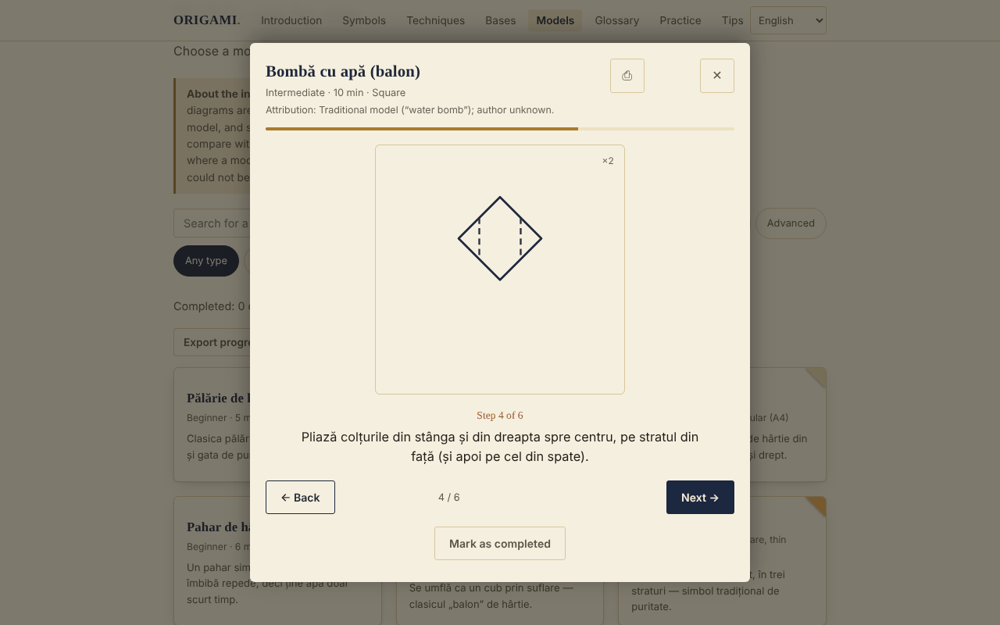

# ORIGAMI — The Art of Paper Folding

**English** · [Română](README.ro.md) · [Français](README.fr.md) · [Italiano](README.it.md) · [Español](README.es.md) · [Português](README.pt.md) · [Deutsch](README.de.md) · [Magyar](README.hu.md)

**Version:** 1.2.6 · **Last updated:** 2026-10-26

Interface languages: **Română, English, Français, Italiano, Español, Português (PT), Deutsch, Magyar**

Offline origami guide in a single HTML file: folding symbols, techniques, fundamental bases and 30 step-by-step models.

**Live:** https://chiuta.github.io/Origami/

## What it is

ORIGAMI is an interactive guide in Romanian: a short historical introduction, the symbols of the Yoshizawa–Randlett notation, 5 compound techniques, 8 bases and a catalogue of 30 models with schematic SVG diagrams and step-by-step descriptions. It opens from a single `index.html` file, with no server and no account.

## Features

Verified in the code and in the browser (Chromium, Playwright):
- Catalogue of 30 models, filterable by level (beginner / intermediate / advanced) and type (traditional-popular / action / modular), with diacritic-free search (for example "palarie" finds "Pălărie").
- Step viewer (SVG diagram + text), with Back / Next buttons, a progress bar and navigation with the left/right arrows; Esc closes it.
- The dialog traps focus (Tab / Shift+Tab), blocks the rest of the page while it is open and returns focus to the model's card on closing.
- "Mark as done" (saved locally, see below).
- Printing: from the viewer all the steps of the model are printed, not just the current step.
- Each model shows its attribution (traditional / known author / "unverified").
- Progress: "Done: N of 30" counter, All / To do / Done filter, "Pick a model for me" button (picks at random among the not-yet-done ones in the current filter), "Reset filters" button when there are no results.
- The viewer remembers the last step seen for each model ("Resumed from step N"); Home / End jump to the first / last step; the `/` key moves focus to search.
- "Export progress" / "Import progress": backup in the file `origami-progres.json` (the models done and the last step seen); on import only valid ORIGAMI files are accepted, unknown models are ignored and existing progress is not deleted.
- For advanced-level models, the viewer displays a note: the diagrams are schematic, the step text takes priority, practice paper is recommended and comparison with a published diagram.
- Respects `prefers-reduced-motion`; mobile-friendly layout (tested at 390 px, no horizontal scroll).

## New features (v1.1.0, 14 October 2026)

### Spaced-repetition practice
New "Practice" section (menu → Practice): **front/back** flashcards for the **folding symbols, compound techniques, bases and glossary** (front = "Folding symbol: …", "Technique: …", "Base: …", "Glossary: …"; back = the description from the app). You self-assess with "Again / Hard / Good / Easy" (keys 1–4; Space shows the answer); the algorithm is **SM-2** (Woźniak, 1990), at most 20 new cards per day, with statistics (due, new, mature, retention) and export of the deck to `.fff.json`. It uses the `srs` module of fff-kit; the cards are created from the app's texts, not from external sources.
- **Storage:** progress is kept in `localStorage` (keys `fff.origami.srs.origami` and `fff.origami.srs.__decks`), only in this browser; it can be deleted from "Transparency" → "Delete".
- **Limits:** the cards test *vocabulary and notation*, not folding skill; the models (the 30) are not cards. If the file is used without the kit (after `fff-kit/build.mjs remove`), the section shows a message and the rest of the guide works normally.

### Transparency and backup (fff-kit)

A click (or Enter) on the displayed version (`v 1.1.0 · 2026-10-14`) opens the "Transparency" window: the declared network hosts (0 external requests), the local storage keys with sizes, the APIs used, the size and SHA-256 of the file (with a checker for a downloaded file) and the **backup** of the app's data to a `.fff.json` file (optionally encrypted with a password, AES-GCM 256 / PBKDF2; the password cannot be recovered), import with confirmation and deletion of the app's data. The kit (`fff-kit`, modules: core, label, bundle, srs) is pasted into `index.html`, makes no network requests and does not change existing data; without it the app works the same. The backup also includes the practice progress and the existing keys `origami-done` / `origami-step`. The kit's texts are in 8 languages (ro, en, fr, it, es, pt, hu, de); **the fr/it/es/pt/hu/de translations are automatic and not verified by native speakers**. The app's own interface remains in Romanian.

## User guide

1. Open the page and choose a section from the top menu (on mobile, the ☰ button).
2. Read "Folding symbols" and "Compound techniques" before the first model.
3. In "Bases" scroll each strip of steps horizontally (with a mouse, a finger or the keyboard, after giving it focus).
4. In "Models" search by name or filter by level and type.
5. Press a model; follow the diagram and the text and move through the steps with "Next →" or with the right arrow.
6. At the end press "Mark as done"; the card gets the "Done ✓" tick.
7. For a paper copy, press ⎙ in the viewer.

## Privacy and network

- Local storage (added in v1.1.0): spaced-repetition practice keeps its progress in the keys `fff.origami.srs.origami` and `fff.origami.srs.__decks`.
- Local storage: `localStorage` is used, with the keys `origami-done` (the models marked "done") and `origami-step` (the last step seen per model). If the browser blocks storage, the app works without it.
- Network: there are no external calls (I found no `fetch`, scripts, fonts or images from other hosts in the code). The page also includes a Content-Security-Policy (script by hash, no `'unsafe-inline'` for scripts) that forbids external connections and resources.
- Browser permissions: it requests none. It contains no telemetry or account.

## Limits and warnings

- The instructions are didactic reconstructions, and the diagrams are schematic, not scale drawings. I could not physically verify each of the 30 models on paper; some steps are approximate (angles, proportions) and may differ from the versions in books. For the advanced models, compare with an origami book.
- "Traditional / popular" means a model in popular circulation. The attribution is shown in the viewer: where the author is known (for example the Sonobe module — Mitsunobu Sonobe; "Toshie's Jewel" — Toshie Takahama) he or she is named, and where the provenance has not been verified, it says so explicitly.
- Some models (fan, 6-point star) use paper that is not a simple square; they do not follow the classic "a single square, no cuts" rule. "Banknote ring": practise on paper and check local legislation before folding real money.
- The diagrams use the dotted line for "mountain"; in books the dash–dot line is usually used.
- The theme follows `prefers-color-scheme` (automatic dark mode).

## Running locally / offline

Download `index.html` and open it in a browser; it does not require internet.

## History / Changelog

### 1.2.4 — 2026-10-22

fff-kit 1.1.4: touch targets and minimum text size.

### 1.2.3 — 2026-10-22
- fff-kit 1.1.2: PBKDF2 600,000 iterations, anti-clickjacking protection

### 14 October 2026 (v1.1.0)
- "Practice" section with spaced repetition (fff-kit `srs`); fff-kit (Transparency + backup). The catalogue of models and the diagrams did not change.

### 12 October 2026 (v1.0.0)
- 1.2.2 — 2026-10-22: On mobile the page no longer jumps to the practice panel on load (focus and scroll position are restored); text ≥ 12 px; diagrams already scale (the strip of steps scrolls horizontally).

- 1.0.0 — 2026-10-12: the version and the date of the last update are shown in the app

### 11 October 2026 (third entry)
- Export/import of progress (JSON), tested: export, local deletion, import, invalid file.
- Note in the viewer for advanced models, about the schematic nature of the diagrams.

### 11 October 2026
- New: progress counter, status filter, "Pick a model for me", resume from the last step, Home/End, the `/` shortcut, filter reset; CSP with a hash for the script. README: corrected that dark mode exists. Screenshot updated.
- Accessibility: the card titles (symbols, techniques, models, tips) are now `h3` under the `h2` sections (axe: 0 violations).
- Crane: step 6 (petal fold) was split into two diagrams (the lift with the reference creases and the "petal" result), so the model now has 14 steps; Hat: the folding of the brim is detailed separately on the front and back of the paper (5 steps).
- The diagrams remain schematic; very short models (for example the Fish, 4 steps) were not extended.

## License

MIT — see the LICENSE file.

## Author

Alexio — Alexandru-Ionuț Chiuță, contact: alexio@trom.tf

## Summary

ORIGAMI is a single-file, offline Romanian-language origami guide: notation symbols, 5 compound techniques, 8 bases and 30 step-by-step models with schematic SVG diagrams. It makes no network requests, has no telemetry, and stores only a "done" checklist in localStorage. The step viewer is keyboard-accessible (focus trap, Esc, arrow keys) and prints all steps of a model. Instructions are didactic reconstructions and have not all been verified on paper; model attribution is shown in-app, with "unverified" where provenance could not be confirmed.
