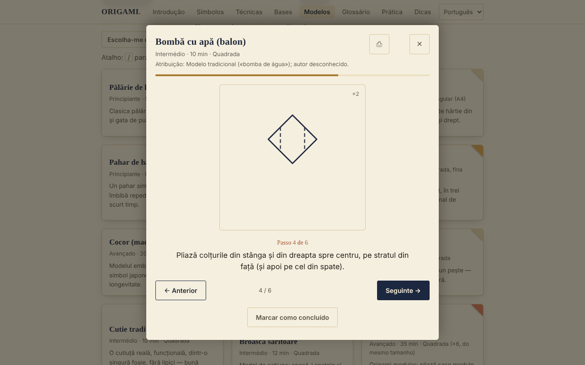

# ORIGAMI — A arte de dobrar papel

[English](README.md) · [Română](README.ro.md) · [Français](README.fr.md) · [Italiano](README.it.md) · [Español](README.es.md) · **Português** · [Deutsch](README.de.md) · [Magyar](README.hu.md)

**Versão:** 1.2.5 · **Última atualização:** 2026-10-23

Idiomas da interface: **Română, English, Français, Italiano, Español, Português (PT), Deutsch, Magyar**

Guia de origami offline num único ficheiro HTML: símbolos de dobragem, técnicas, bases fundamentais e 30 modelos passo a passo.

**Online:** https://chiuta.github.io/Origami/

## O que é

O ORIGAMI é um guia interativo em romeno: uma breve introdução histórica, os símbolos da notação Yoshizawa–Randlett, 5 técnicas compostas, 8 bases e um catálogo de 30 modelos com diagramas SVG esquemáticos e descrições passo a passo. Abre-se a partir de um único ficheiro `index.html`, sem servidor e sem conta.

## Funcionalidades

Verificadas no código e no navegador (Chromium, Playwright):
- Catálogo de 30 modelos, filtrável por nível (iniciante / intermédio / avançado) e tipo (tradicional-popular / ação / modular), com pesquisa sem diacríticos (por exemplo, «palarie» encontra «Pălărie»).
- Visualizador passo a passo (diagrama SVG + texto), com botões Anterior / Seguinte, barra de progresso e navegação com as setas esquerda/direita; Esc fecha-o.
- A caixa de diálogo retém o foco (Tab / Shift+Tab), bloqueia o resto da página enquanto está aberta e devolve o foco ao cartão do modelo ao fechar.
- «Marcar como realizado» (guardado localmente, ver abaixo).
- Impressão: a partir do visualizador imprimem-se todos os passos do modelo, não apenas o passo atual.
- Cada modelo mostra a atribuição (tradicional / autor conhecido / «não verificado»).
- Progresso: contador «Realizados: N de 30», filtro Todos / Por fazer / Realizados, botão «Escolhe-me um modelo» (escolhe ao acaso entre os não realizados do filtro atual), botão «Repor filtros» quando não há resultados.
- O visualizador recorda o último passo visto em cada modelo («Retomado a partir do passo N»); Home / End saltam para o primeiro / último passo; a tecla `/` move o foco para a pesquisa.
- «Exportar o progresso» / «Importar o progresso»: cópia de segurança no ficheiro `origami-progres.json` (os modelos realizados e o último passo visto); na importação só se aceitam ficheiros ORIGAMI válidos, os modelos desconhecidos são ignorados e o progresso existente não é apagado.
- Nos modelos de nível avançado, o visualizador apresenta uma nota: os diagramas são esquemáticos, o texto do passo tem prioridade, recomenda-se papel de teste e a comparação com um diagrama publicado.
- Respeita `prefers-reduced-motion`; disposição adaptada a dispositivos móveis (testada a 390 px, sem deslocamento horizontal).

## Novidades (v1.1.0, 14 de outubro de 2026)

### Treino com repetição espaçada
Nova secção «Treino» (menu → Treino): cartões com **frente/verso** para os **símbolos de dobragem, as técnicas compostas, as bases e o glossário** (frente = «Símbolo de dobragem: …», «Técnica: …», «Base: …», «Glossário: …»; verso = a descrição da aplicação). Autoavalia-se com «Outra vez / Difícil / Bem / Fácil» (teclas 1–4; Espaço mostra a resposta); o algoritmo é o **SM-2** (Woźniak, 1990), com no máximo 20 cartões novos por dia, com estatísticas (a rever, novos, maduros, retenção) e exportação do baralho para `.fff.json`. Usa o módulo `srs` do fff-kit; os cartões são criados a partir dos textos da aplicação, não de fontes externas.
- **Armazenamento:** o progresso é guardado em `localStorage` (chaves `fff.origami.srs.origami` e `fff.origami.srs.__decks`), apenas neste navegador; pode ser apagado em «Transparência» → «Eliminar».
- **Limites:** os cartões testam o *vocabulário e a notação*, não a destreza a dobrar; os modelos (os 30) não são cartões. Se o ficheiro for usado sem o kit (após `fff-kit/build.mjs remove`), a secção mostra uma mensagem e o resto do guia funciona normalmente.

### Transparência e cópia de segurança (fff-kit)

Um clique (ou Enter) na versão apresentada (`v 1.1.0 · 2026-10-14`) abre a janela «Transparência»: os anfitriões de rede declarados (0 pedidos externos), as chaves de armazenamento local com tamanhos, as API usadas, o tamanho e o SHA-256 do ficheiro (com um verificador para um ficheiro descarregado) e a **cópia de segurança** dos dados da aplicação num ficheiro `.fff.json` (opcionalmente cifrado com palavra-passe, AES-GCM 256 / PBKDF2; a palavra-passe não pode ser recuperada), a importação com confirmação e a eliminação dos dados da aplicação. O kit (`fff-kit`, módulos: core, label, bundle, srs) está incorporado em `index.html`, não faz pedidos de rede e não altera os dados existentes; sem ele a aplicação funciona da mesma forma. A cópia de segurança inclui também o progresso do treino e as chaves existentes `origami-done` / `origami-step`. Os textos do kit estão em 8 idiomas (ro, en, fr, it, es, pt, hu, de); **as traduções fr/it/es/pt/hu/de são automáticas e não verificadas por falantes nativos**. A interface da própria aplicação continua em romeno.

## Manual de utilização

1. Abra a página e escolha uma secção no menu superior (no telemóvel, o botão ☰).
2. Leia «Símbolos da dobragem» e «Técnicas compostas» antes do primeiro modelo.
3. Em «Bases» desloque horizontalmente cada faixa de passos (com o rato, o dedo ou o teclado, depois de lhe dar o foco).
4. Em «Modelos» pesquise por nome ou filtre por nível e tipo.
5. Prima um modelo; acompanhe o diagrama e o texto e avance pelos passos com «Seguinte →» ou com a seta direita.
6. No final prima «Marcar como realizado»; o cartão recebe o visto «Realizado ✓».
7. Para uma cópia em papel, prima ⎙ no visualizador.

## Privacidade e rede

- Armazenamento local (acrescentado na v1.1.0): o treino com repetição espaçada guarda o progresso nas chaves `fff.origami.srs.origami` e `fff.origami.srs.__decks`.
- Armazenamento local: usa-se `localStorage`, com as chaves `origami-done` (os modelos marcados como «realizado») e `origami-step` (o último passo visto por modelo). Se o navegador bloquear o armazenamento, a aplicação funciona sem ele.
- Rede: não existe nenhuma chamada externa (não encontrei no código `fetch`, scripts, tipos de letra ou imagens de outros anfitriões). A página inclui também uma Content-Security-Policy (script por hash, sem `'unsafe-inline'` para scripts) que proíbe ligações e recursos externos.
- Permissões do navegador: não pede nenhuma. Não contém telemetria nem conta.

## Limites e avisos

- As instruções são reconstituições didáticas, e os diagramas são esquemáticos, não desenhos à escala. Não consegui verificar fisicamente, em papel, cada um dos 30 modelos; alguns passos são aproximados (ângulos, proporções) e podem diferir das versões dos livros. Para os modelos avançados, compare com um livro de origami.
- «Tradicional / popular» significa um modelo de circulação popular. A atribuição é apresentada no visualizador: quando o autor é conhecido (por exemplo, o módulo Sonobe — Mitsunobu Sonobe; «Toshie's Jewel» — Toshie Takahama) é nomeado, e quando a proveniência não foi verificada, di-lo explicitamente.
- Alguns modelos (leque, estrela de 6 pontas) usam papel que não é um quadrado simples; não respeitam a regra clássica «um só quadrado, sem cortes». «Anel de nota»: pratique em papel e verifique a legislação local antes de dobrar dinheiro verdadeiro.
- Os diagramas usam a linha ponteada para «montanha»; nos livros costuma usar-se a linha ponto–traço.
- O tema segue `prefers-color-scheme` (modo escuro automático).

## Execução local / offline

Descarregue `index.html` e abra-o no navegador; não requer internet.

## Histórico / Changelog

### 1.2.4 — 2026-10-22

fff-kit 1.1.4: alvos de toque e tamanho mínimo do texto.

### 1.2.3 — 2026-10-22
- fff-kit 1.1.2: PBKDF2 com 600.000 iterações, proteção anti-clickjacking

### 14 de outubro de 2026 (v1.1.0)
- Secção «Treino» com repetição espaçada (fff-kit `srs`); fff-kit (Transparência + cópia de segurança). O catálogo de modelos e os diagramas não mudaram.

### 12 de outubro de 2026 (v1.0.0)
- 1.2.2 — 2026-10-22: No telemóvel a página já não salta para o painel de prática ao abrir (foco e posição de deslocamento restaurados); texto ≥ 12 px; os diagramas já se adaptam (a faixa de passos desloca-se na horizontal).

- 1.0.0 — 2026-10-12: a versão e a data da última atualização são apresentadas na aplicação

### 11 de outubro de 2026 (terceira entrada)
- Exportação/importação do progresso (JSON), testada: exportação, eliminação local, importação, ficheiro inválido.
- Nota no visualizador para os modelos avançados, sobre o caráter esquemático dos diagramas.

### 11 de outubro de 2026
- Novo: contador de progresso, filtro de estado, «Escolhe-me um modelo», retoma a partir do último passo, Home/End, atalho `/`, reposição de filtros; CSP com hash para o script. README: corrigido que existe modo escuro. Captura de ecrã atualizada.
- Acessibilidade: os títulos dos cartões (símbolos, técnicas, modelos, dicas) são agora `h3` sob as secções `h2` (axe: 0 violações).
- Grou: o passo 6 (dobra em pétala) foi dividido em dois diagramas (a elevação com as dobras de referência e o resultado «pétala»), pelo que o modelo tem agora 14 passos; Chapéu: a dobragem da aba é detalhada separadamente na frente e no verso do papel (5 passos).
- Os diagramas continuam esquemáticos; os modelos muito curtos (por exemplo, o Peixe, 4 passos) não foram alargados.

## Licença

MIT — ver o ficheiro LICENSE.

## Autor

Alexio — Alexandru-Ionuț Chiuță, contacto: alexio@trom.tf

## Resumo

O ORIGAMI é um guia de origami offline, de ficheiro único e em língua romena: símbolos de notação, 5 técnicas compostas, 8 bases e 30 modelos passo a passo com diagramas SVG esquemáticos. Não faz pedidos de rede, não tem telemetria e guarda em localStorage apenas uma lista de verificação dos modelos «realizados». O visualizador de passos é acessível por teclado (armadilha de foco, Esc, setas) e imprime todos os passos de um modelo. As instruções são reconstituições didáticas e nem todas foram verificadas em papel; a atribuição dos modelos é apresentada na aplicação, com «não verificado» quando a proveniência não pôde ser confirmada.
